 

**Production-grade software, AI, and automation — delivered by senior teams in Nepal and the USA.**

## Who we are

Cloud Axcel started in 2019 as a small team taking on software projects other agencies wouldn't scope properly, built around one standard: **ship things that work, and stay around after launch to prove it.**

Seven years later, we've grown past 30 people and delivered 50+ projects across hospitality, healthcare, food and beverage, and other industries — holding a 98% client satisfaction rate along the way.

> **Mission** — Ship production-grade software and AI that measurably moves our clients' business forward.
>
> **Vision** — To be the technology partner clients call first, because we stick around after launch instead of moving on to the next sale.

## What we do

We also deliver end-to-end **web development, mobile development, cloud solutions, cybersecurity, and DevOps automation**.

## Tech stack

…plus custom third-party APIs to connect the tools businesses already run on.

## How we work

## Get in touch

📧 [customersuccess@cloudaxcel.com](mailto:customersuccess@cloudaxcel.com) &nbsp;·&nbsp; 🌐 [cloudaxcel.com](https://cloudaxcel.com) &nbsp;·&nbsp; 💼 [LinkedIn](https://www.linkedin.com/company/cloudaxcel/life/)

© 2026 CloudAxcel, Inc.

